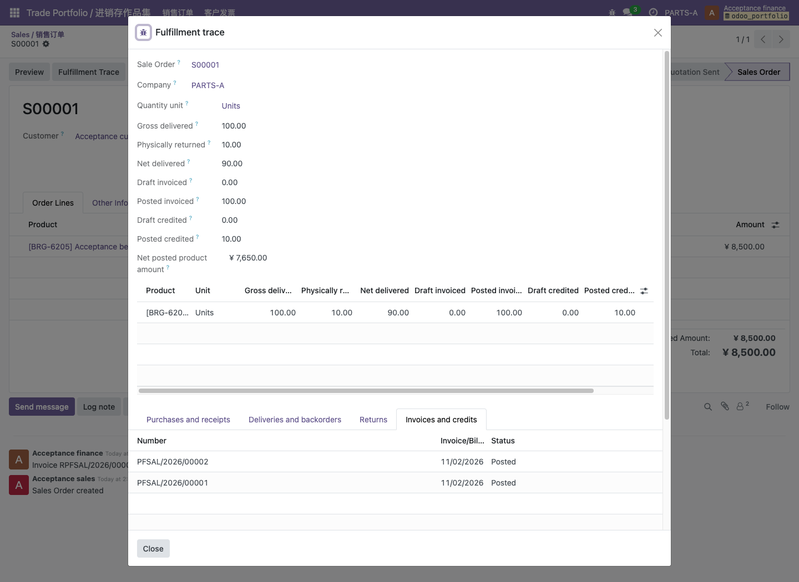

# Odoo ERP Portfolio / 进销存 ERP 作品集

以 Odoo 18 社区版为基础的工业配件分销 ERP 个人工程项目。业务闭环：客户报价、审批、缺货采购、分批交付、开票、退货和贷项；外部订单接入在业务闭环之后开发。

工业配件分销需求与方案基线0.1已经确认，M0已通过原生环境安装、模块加载、登录和菜单检查，见[实测记录](docs/quality/m0-verification.md)。M1的报价审批子模块已实现：公司级阈值、禁止自审、负责销售确认、改单失效、不可变审计及并发保护，通过32个真实Odoo测试和独立审查，操作说明见[审批验收记录](docs/quality/m1-sales-approval.md)。

M1现已补齐独立的主数据校验、业务角色及可重复的本地验收数据工具，见[主数据验证与操作说明](docs/quality/m1-master-data.md)。M2a实现采购来源追踪、仓库完成权限、分批收发货、实物库存约束及共享库存并发保护，完整回归通过182个真实Odoo测试，见[采购与库存验证记录](docs/quality/m2a-fulfillment.md)。

M2b已合并：真实交付开票额度、实物退货来源、贷项双重额度和原始价格归属，以及纯财务角色开票入口和部分贷项向导。全新安装、1.4.0升级和最终GitHub CI均通过完整337个Odoo测试，独立规格/代码质量审查通过，包含六项真实事务并发竞争；隔离测试中的全角色流程核对库存10、净交付90、真实净过账7650，见[开发与验证记录](docs/quality/m2b-invoice-return.md)及[财务操作说明](docs/quality/m2b-finance-operations.md)。M2b交付时已验证开发库1.4.0、原19标识、库存40和一次期初盘点保留，七角色登录通过，履约策略保持关闭。

M2c已通过[PR #12](https://github.com/xdfu-nier/odoo-erp-portfolio/pull/12)合并：只读履约追踪、本地CNY会计准备、真实角色业务链路及七角色HTTP/浏览器核对。模块1.5.0通过412项本地Odoo测试及最终CI，见[页面与开发库验收记录](docs/quality/m2c-role-pages.md)。开发库两次相同流程核对库存10、净交付90、实际商品分录净过账7650，原19个标识及40件期初盘点保留，B公司策略不变。

M3正在[PR #13](https://github.com/xdfu-nier/odoo-erp-portfolio/pull/13)开发：独立插件提供来源/客户/SKU映射、认证接收、精确业务摘要、数据库幂等、原生草稿报价、失败审计、带原因重试、默认停用的处理计划及真实并发/进程退出恢复。当前本地600项Odoo测试通过，开发库两单导入及五角色HTTP通过；五角色浏览器与最终CI尚待验收，见[M3验证记录](docs/quality/m3-order-bridge.md)。完整人工UAT、备份恢复与性能尚未完成。

实际财务角色页面：只读销售来源、实物交付与退货、已过账数量和原生单据关联。截图使用虚构验收数据。



开发按照“案例调研 → 需求评审 → Odoo差异分析 → 分里程碑实现 → 集成测试 → 业务验收 → 发布恢复验证”推进。文档入口见[需求与交付文档](docs/requirements.md)，具体完成条件见[里程碑与流程](docs/delivery/workflow.md)。

默认使用源码开发环境，新增依赖安装在当前目录内：

| 路径 | 用途 |
| --- | --- |
| `.tools/` | 项目专用 Python、数据库程序及辅助工具 |
| `.venv/` | Python 虚拟环境 |
| `.upstream/odoo/` | Odoo 官方源码，不随作品集重复提交 |
| `.runtime/` | PostgreSQL 数据、Odoo 配置、文件存储及日志 |
| `addons/portfolio_trade/` | 自主开发的业务扩展模块 |
| `addons/portfolio_order_bridge/` | 外部订单接收、映射、任务及报价处理插件 |
| `scripts/` | 环境初始化、开发启动及测试命令 |
| `docs/` | 需求来源、实现方案、演示与验证记录 |

## 本地开发

要求 macOS Apple Silicon / Intel 或 Linux x86_64，系统已有 `curl` 和 `uv`。也可以把 uv 可执行文件放在 `.tools/bin/uv`。Python 3.12 会自动下载到 `.tools/python`，不会修改全局 Python 或 PATH。

```bash
# 安装项目内 Python、虚拟环境依赖和固定版本的 Odoo 源码
./scripts/setup.sh

# 初始化项目内 PostgreSQL 数据目录并安装自定义模块
.venv/bin/python scripts/manage.py init

# 启动源码开发服务
.venv/bin/python scripts/manage.py start
```

打开 <http://127.0.0.1:8069>。新建开发数据库的初始 Odoo 登录账号为 `admin` / `admin`。数据库连接密码和数据库管理密码在首次配置时随机生成，保存在被 Git 忽略的 `.env` 中；它们与页面登录密码不同。

PostgreSQL 二进制由 `pgserver` wheel 安装在 `.venv` 中；数据存放在 `.runtime/postgres`，仅监听 `127.0.0.1:55432`。Odoo 使用独立的非超级用户数据库角色。停止 Odoo 后，数据库保持运行，可用以下命令停止：

```bash
.venv/bin/python scripts/manage.py stop-db
```

修改模型或 XML 后更新模块：

```bash
.venv/bin/python scripts/manage.py update
```

显式准备虚构的工业配件验收数据，再启动服务：

```bash
.venv/bin/python scripts/prepare_acceptance.py --database odoo_portfolio --allow-local-acceptance \
  > .runtime/m1-acceptance.json
```

工具创建独立业务角色、客户/供应商、三个商品及40个轴承的标准期初盘点。账号密码仅保存到项目内私有文件 `.runtime/acceptance-accounts.json`。重复执行保留手工编辑，不重复盘点；模块安装不会自动生成这些数据。

模块升级完成后，显式准备CNY会计和站内发件身份，再启用PARTS-A并执行独立验收流程：

```bash
.venv/bin/python scripts/prepare_local_finance.py --database odoo_portfolio --allow-local-acceptance --check
.venv/bin/python scripts/prepare_local_finance.py --database odoo_portfolio --allow-local-acceptance
.venv/bin/python scripts/run_local_fulfillment.py --database odoo_portfolio --allow-local-acceptance --prepare-senders
.venv/bin/python scripts/prepare_local_finance.py --database odoo_portfolio --allow-local-acceptance --enable-fulfillment
.venv/bin/python scripts/run_local_fulfillment.py --database odoo_portfolio --allow-local-acceptance
```

会计与流程使用各自命名空间，未知配置、额外库存历史或已修改的验收单据会被拒绝覆盖。完整流程重复执行只核对原单据，返回相同报告，不重建订单或恢复库存。财务操作和逐角色页面命令见[本地验收指南](docs/quality/m2c-role-pages.md)。应用运行继续使用项目内Python/PostgreSQL；浏览器验收另使用已有Node22和Chrome，不新增npm依赖。

外部接入插件沿用原生`sale.order`，通过模型继承、ORM、XML视图、ACL/公司规则和`ir.cron`扩展Odoo；Odoo框架来自`.upstream/odoo`，由项目`.venv`中的Python启动。它不是一个单独的pip包，也不要求Docker。Bridge须另行安装，既有`manage.py init/update`只处理`portfolio_trade`；准确安装、准备和角色入口见[导入模块本地操作说明](docs/quality/m3-local-operations.md)。

VS Code 打开本项目目录，选择 `.venv/bin/python` 后使用 `Odoo: source development` 启动配置。数据库须先完成初始化并保持运行。调试配置需要 VS Code 的 Python Debugger 扩展。

## 依赖管理

- Odoo 源码版本固定在 [odoo-source.lock](odoo-source.lock)，下载到 `.upstream/odoo`；保留已有不同版本的源码目录，避免覆盖个人修改。
- [requirements-dev.txt](requirements-dev.txt)记录Odoo兼容的开发依赖来源；实际安装使用已验证CPython 3.12环境生成的[requirements-dev.lock](requirements-dev.lock)，固定包括间接依赖在内的66个包。
- 原生开发使用 `psycopg2-binary`，避免全局安装 libpq；当前范围不包含 LDAP 登录，因此未引入需要额外本机开发库的 `python-ldap`。
- `.tools`、`.venv`、`.cache`、`.runtime`、`.upstream` 与 `.env` 不提交到 GitHub。
- 启动脚本只管理本项目数据库，不注册系统服务；不要求 Docker。

## 当前验证

```bash
.venv/bin/python -X pycache_prefix=.cache/pycache -m unittest discover -s tests -v
.venv/bin/python -X pycache_prefix=.cache/pycache -m compileall -q scripts addons tests
node --test tests/browser_m2c_check.test.js
```

当前162个Python辅助测试覆盖项目内路径、私有凭据、配置与命令行、幂等准备、精确载荷解析、HTTP角色证据和输入覆盖保护；既有27个Node测试覆盖真实渲染证据、字段可见性、菜单切换、原生空状态、脱敏启动诊断、IPC清理及原子记录点击。已发布CI执行原生Odoo测试、两次M1准备、显式会计/发件配置、两次M2角色流程及七角色HTTP/浏览器核对，仅上传白名单报告和截图。M3新增HTTP和浏览器的CI结果单独记录，业务测试命令及确切提交结果见上述质量记录；自动化核对与人工UAT分别记录。

## 开发顺序

| 里程碑 | 目标 | 完成证据 |
| --- | --- | --- |
| M0 | 项目内开发环境可用 | 实际安装、启动、登录及模块安装记录 |
| M1 | 主数据与报价审批 | 主数据、审批、角色及本地验收工具已实现，87个Odoo测试通过；完整人工验收未完成 |
| M2 | 采购到退货的履约闭环 | PR #12已合并；412项测试、七角色HTTP/浏览器及最终CI通过 |
| M3 | 外部订单接入 | 600项本地测试、开发库两单和五角色HTTP通过；新浏览器/最终CI及PR #13合并待完成 |
| M4 | 发布和恢复 | 新库安装、升级、备份恢复及性能记录 |

真实案例来源与本项目规则在[调研记录](docs/discovery/case-research.md)中区分。14条需求对应[28个验收场景](docs/quality/acceptance.md)，已验证的自动化子集和未执行的人工验收分别记录。测试公司、客户及单据使用虚构数据。
