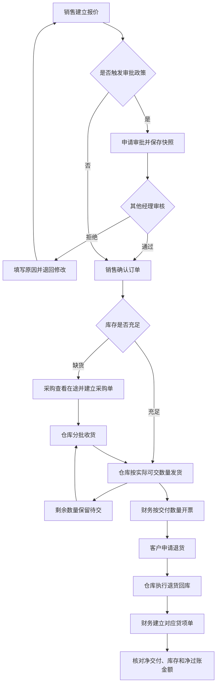

# 工业配件分销 ERP：方案设计 0.1

状态：方案基线0.1已随需求于2026-10-26获得项目负责人确认，技术审查补齐并发和退货语义。以[需求基线](../product/prd.md)为准；M0与M1主数据/审批代码已有实际验证，M2正在按固定源码细化实现。

## 1. Odoo 标准能力与定制边界

| 能力 | 标准模块/模型 | 自主实现 |
| --- | --- | --- |
| 主数据 | product.product、res.partner、res.company | 外部编号映射与公司校验、验收数据 |
| 销售 | sale_management、sale.order/line | 审批政策、审批申请历史、关键字段变更约束 |
| 采购 | purchase_stock、purchase.order | 来源销售关联与查询；不直接重写采购计划器 |
| 库存 | sale_stock、stock.picking/move | 发货约束、单据追踪与数量校验；复用标准预留、补交及退货向导 |
| 发票 | account、account.move/line | 可开票数量保护和来源汇总；复用标准过账与贷项单 |
| 接入 | Odoo 已认证外部 API、ir.cron | 独立接收任务、幂等约束、处理与重试 |

已核对固定源码：销售行的 `qty_to_invoice` 根据商品开票策略、交付和开票数量计算；`sale_stock` 使用库存移动及退货标记计算交付数量。实现必须保留这些语义，不能另建一套与标准单据失联的库存/财务账。

源码依据：[sale_order_line.py](https://github.com/odoo/odoo/blob/98e48692891fc9a3aaa7f53001305b322f53cfa2/addons/sale/models/sale_order_line.py)、[sale_stock 扩展](https://github.com/odoo/odoo/blob/98e48692891fc9a3aaa7f53001305b322f53cfa2/addons/sale_stock/models/sale_order_line.py)。

## 2. 模块边界

`portfolio_trade` 管理销售审批、商业字段约束、采购关联和单据追踪。未来 `portfolio_order_bridge` 依赖它，单独管理外部来源、主数据映射、接收任务和处理器。依赖单向，进销存不依赖外部接入即可运行。

标准 Odoo 源码固定版本，存放 `.upstream/odoo`，作为运行时下载项。自定义代码只放在 `addons/`；模型继承、视图继承和标准方法调用均可在本项目中追踪。禁止直接修改上游源码解决业务需求。

## 业务流程



该图描述存在缺货和退货的验收路径；待交可以因实际业务取消，退货也不是每张订单必须发生的步骤。退货的库存处理与贷项的财务处理由不同角色分别完成。

## 3. 审批数据与并发

公司保存金额/折扣阈值及政策版本。销售订单保存审批状态和当前有效申请。独立审批记录保存申请人、审核人、时间、拒绝原因、关键字段快照及摘要；申请历史只追加，不允许普通用户修改既有结论。

提交、批准、拒绝、确认，以及审批相关订单字段和销售行的新增/修改/删除，必须在变更前按相同协议获取父订单锁，并在锁内再次验证角色、公司、订单状态和当前快照。涉及多张订单按ID顺序加锁。加锁等待后重新读取关键字段，不能继续使用过期 ORM 缓存。

公司政策使用版本识别，所有确认按当前政策重新核对，政策变更与确认必须有一致的序列化顺序。并发验收包括确认与行新增/修改/删除、审批与改单、确认与政策更新，不能仅测试两次审批。

审批相关字段不可由外部 `create/write` 设置；内部状态变化不使用可被调用方伪造的 context 标志作为权限凭据。管理员/系统维护权限和普通经理业务权限分别测试。

## 4. 数量、采购与追踪

采购单使用受公司一致性检查的销售订单关联字段，用于来源追踪。库存仍属于仓库公共库存池，关联字段不产生隐含分配承诺。采购员基于标准预测和在途信息做补货决策；首版不承诺自动生成净缺货量。

数量均通过商品计量单位换算及对应舍入精度比较。真实库存、待交、已交、退回、已开票和已过账分别展示。草稿发票可能占用标准“可开票”数量，但不计入“已过账应收”。退货的库存流转和退款的财务流转分别完成、分别记录。

客户退货必须关联原交付移动，并在本项目路径强制启用标准“更新销售/采购数量”语义（库存移动 `to_refund=True`）；否则标准销售净交付数量不会减少。贷项行保留原销售行及原发票来源关系，以标准数量换算口径计算累计已贷数量。

本项目贷项必须晚于对应实物退货，累计额度按已退货未贷数量与原已过账发票未贷数量的较小值控制，并计入未取消草稿贷项，防止两张草稿重复占用同一额度。原交付/退货及原发票上的额度检查必须覆盖并发申请。禁止靠负交付或负开票汇总掩盖超量操作，也不能因先建贷项重新产生可开票量。

自定义发货/开票约束放在可被界面和接口共同调用的服务端路径，并用绕过界面操作的测试证明有效。具体扩展方法在对应开发任务中结合 Odoo 安装后的行为确定。

## 5. 外部订单接入契约

使用已认证的 Odoo API 调用 `portfolio.import.job.submit_order(payload)`，显式要求接入角色与来源授权。不新建匿名 HTTP 入口，不让调用方传任意模型或方法。

示例载荷使用虚构数据：

```json
{
  "company_code": "PARTS-A",
  "source_code": "B2B",
  "external_order_id": "EXT-20261026-001",
  "customer_ref": "CUST-001",
  "currency": "CNY",
  "lines": [
    {"external_line_id": "1", "sku": "BRG-6205", "quantity": "100", "unit_price": "100.00", "discount": "15.00"}
  ]
}
```

数量、价格及折扣使用十进制字符串，拒绝非有限值、负数、重复行号、空订单和商品单位不支持的精度。按行号排序、按单位/币种精度规范化后计算业务摘要；纯请求跟踪 ID 和发送时间不参与摘要。

幂等键为 `(company_id, source_id, external_order_id)`，在数据库建立唯一约束。同键同摘要返回原任务；同键不同摘要报冲突。来源本身绑定公司，调用方即使被授权访问多个公司，也不能把 A 公司的来源与 B 公司的客户/商品混用。

## 6. 接收、处理与失败恢复

接收事务仅写入 `pending` 任务并返回任务标识，提交后才可由处理器执行。处理器从到期任务中用 `FOR UPDATE SKIP LOCKED` 领取记录，按固定批次执行；任务状态为 `pending → processing → done/failed`。

每张订单的创建在保存点内完成。业务异常回滚保存点内订单及关联写入，保存点外记录失败类型和说明，使失败记录能够持久化。成功时任务与订单关联在同一事务内提交；进程退出导致未提交事务回滚，任务仍可重新处理。

首版不做自动重试策略：主数据或规则问题修复后，由有权人员填写原因后人工重试；同一个任务再次进入 `pending`，保留尝试次数和历史。已成功任务不可重试生成新单。数据库层瞬态冲突由 Odoo 事务机制处理，并用并发测试核对实际行为。

## 7. 权限与审计

自定义业务记录必须有公司归属，设置模型 ACL、全局公司记录规则和关联字段公司一致性检查。审批历史对普通用户只读；导入原始载荷和内部失败信息仅向接入/运维授权角色开放，销售只能查看业务结果。

业务操作采用当前用户权限。需要系统调度执行的导入任务使用专用最小权限角色，按任务公司切换环境并再次验证来源和映射；不使用全局 `sudo()` 解决访问失败。

## 8. 环境、升级与发布

源码开发、Python、PostgreSQL、依赖和缓存均按既有项目内目录管理。M0 要实际完成原生安装、模块安装和启动验证，不能以脚本存在代替环境可用。

每个功能在独立分支开发，通过 PR 关联需求和验收编号。字段新增优先采用可兼容升级，执行 `-u` 前备份；涉及数据转换时提供明确迁移脚本。发布必须记录源码提交、上游版本、模块版本、测试结果及恢复验证。回滚不得通过删除业务记录达成。
