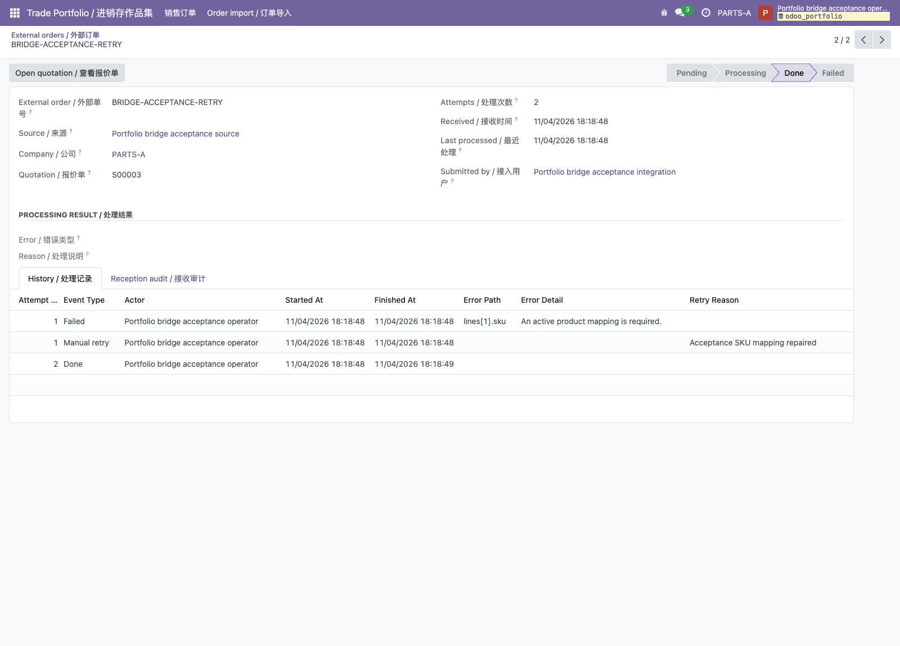
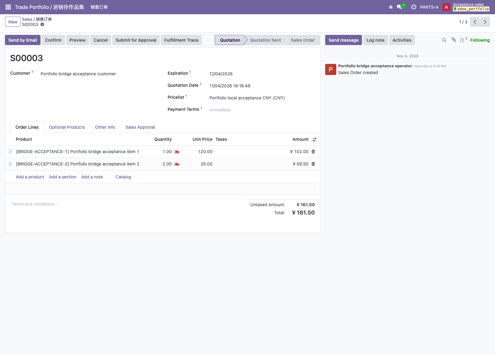

# 外部订单接入：本地开发与角色入口

状态：Bridge `18.0.1.3.0`已通过PR #13合并，开发库两单、五角色HTTP/真实浏览器19页、最终CI及main实际复验通过；确切证据见[M3验证记录](m3-order-bridge.md)。这是虚构业务数据的个人作品集，不连接真实客户系统。

## 框架和自定义插件的关系

固定版本Odoo18官方源码放在`.upstream/odoo`，Python依赖安装在`.venv`。项目内Python执行官方`odoo-bin`，通过`addons_path`加载官方插件及本项目`addons`。`portfolio_trade`继承销售/采购/库存/会计模型实现业务约束，`portfolio_order_bridge`依赖它，将授权来源的订单转换成原生草稿报价。

Bridge使用Odoo ORM与数据库唯一键保存任务，XML定义原生菜单/表单，ACL/记录规则及方法内实际用户检查控制权限；`ir.cron`提供可选自动处理。无需另外启动Web框架、消息队列或Docker。框架源码与Python依赖锁定方式见[README](../../README.md)。

## 安装顺序

先按README完成项目环境、`manage.py init`、M1验收数据、CNY会计及M2完整履约流程。以下命令在项目根目录执行，数据库保持运行，Odoo开发服务先停止。安装与升级应使用包含两个插件的同一份源码。

```bash
# manage.py init/update目前只处理trade；首次额外安装Bridge
.venv/bin/python .upstream/odoo/odoo-bin -c .runtime/odoo.conf \
  -d odoo_portfolio -i portfolio_order_bridge --without-demo=all --stop-after-init

# 创建独立的来源、映射、商品及三位普通角色；专用计划默认停用
.venv/bin/python scripts/prepare_order_bridge.py --config .runtime/odoo.conf \
  --database odoo_portfolio --allow-local-acceptance > .runtime/m3-profile-first.json
.venv/bin/python scripts/prepare_order_bridge.py --config .runtime/odoo.conf \
  --database odoo_portfolio --allow-local-acceptance > .runtime/m3-profile-second.json
cmp .runtime/m3-profile-first.json .runtime/m3-profile-second.json

# 用真实Integration/Operator/Settings执行两单，第二单包含失败、修复、带原因重试
.venv/bin/python scripts/run_local_order_import.py --config .runtime/odoo.conf \
  --database odoo_portfolio --allow-local-acceptance > .runtime/m3-import-first.json
.venv/bin/python scripts/run_local_order_import.py --config .runtime/odoo.conf \
  --database odoo_portfolio --allow-local-acceptance > .runtime/m3-import-second.json
cmp .runtime/m3-import-first.json .runtime/m3-import-second.json

.venv/bin/python scripts/manage.py start
```

重复执行profile只核对完整配置，重复执行完成流程只读复验两单，不新增报价或重置库存。未知同名、被修改或不完整数据会拒绝覆盖，应先定位差异。Bridge模型/XML后续升级须停服执行相同`odoo-bin`命令，将`-i portfolio_order_bridge`改成`-u portfolio_order_bridge`；不要用旧源码启动已安装新模型的数据库。

## 本地角色及查看路径

三位新增角色的登录名/随机密码只保存在`.runtime/order-bridge-accounts.json`，原七角色仍在`.runtime/acceptance-accounts.json`。两份文件权限600且不提交Git。角色应分别登录本机`http://127.0.0.1:8069`；切换角色先退出当前会话。

| 角色 | 原生入口与职责 | 本地流程证据 |
| --- | --- | --- |
| Settings | Trade Portfolio / 进销存作品集→Order import / 订单导入→Import settings / 导入配置：来源、客户/SKU映射、准备停用计划 | 来源A公司、负责Sales、专用Operator；客户1条、商品3条（含修复别名） |
| Integration | 外部订单、尝试记录；授权来源接收及只读原始载荷 | 两个done任务、原始接收人与报文、四条尝试；无报价或处理权限 |
| Operator | 外部订单及尝试、处理待办、失败原因向导、查看原生报价 | 第一单处理1次，第二单处理2次；done任务不能再次重试 |
| M1 Sales | 原生销售报价 | 两张草稿309元/161.50元；负责人Sales、创建人Operator，15%折扣仍须审批 |
| B公司销售 | B公司自己的销售列表 | 看不到A公司导入菜单、报文及两张报价 |

第二单保留失败/重试/成功历史和原因，页面检查读取已完成结果，不再次执行重试。任务和尝试不允许通过通用CRUD篡改。原始报文只用于内存比较，不进入公共验收报告。

## 认证HTTP复验

下面读取前述报告并建立五个独立本机会话；Integration重复接收同内容复用原任务，Operator空队列处理返回0，Sales确认被审批规则阻止。其余权限反例和健康读取必须全部通过，输出只含白名单安全字段。

```bash
.venv/bin/python scripts/verify_order_bridge_roles.py \
  --base-url http://127.0.0.1:8069 --database odoo_portfolio \
  --credentials .runtime/order-bridge-accounts.json \
  --sales-credentials .runtime/acceptance-accounts.json \
  --acceptance-report .runtime/m1-acceptance.json \
  --profile-report .runtime/m3-profile-second.json --flow-report .runtime/m3-import-second.json \
  --output .runtime/m3-http.json
```

`--acceptance-report`使用README中本机第一次M1准备保存的安全十九标识报告；若此前保存到其他runtime文件，替换该路径。

使用已有Node22及Chrome，五角色分别经原生登录页建立独立会话，并核对19个页面：

```bash
node scripts/browser_order_bridge_check.js \
  --base-url http://127.0.0.1:8069 --database odoo_portfolio \
  --credentials .runtime/order-bridge-accounts.json \
  --sales-credentials .runtime/acceptance-accounts.json \
  --acceptance-report .runtime/m1-acceptance.json \
  --profile-report .runtime/m3-profile-second.json --flow-report .runtime/m3-import-second.json \
  --role-report .runtime/m3-http.json --output-dir .runtime/m3-browser
```

浏览器读取已经完成的历史，不再提交、重试或创建第三单。`report.json`和19张固定PNG保存在输出目录；接收审计中的原始/规范报文及摘要先核对只读，再遮盖截图。实际验收角色没有启用原生折扣和单位显示组：报价页面核对可见商品、数量、单价、税、小计及总额，隐藏折扣列用可见金额关系计算并标明来源；真实折扣/单位同时由HTTP核对，不把隐藏列描述为浏览器可见。





## 可选自动处理

本地默认`max_cron_threads=0`，来源专用计划也默认inactive。手动“处理待办”不依赖cron。若要开发自动处理，先由Settings核对来源专用计划的Job模型、处理方法、Operator及1分钟周期，再显式启用计划。停止原开发服务、确认项目数据库仍运行后，直接启动官方入口并显式覆盖线程数：

```bash
.venv/bin/python .upstream/odoo/odoo-bin -c .runtime/odoo.conf \
  -d odoo_portfolio --max-cron-threads=1 --dev=xml
```

计划启用与正数线程两项条件均满足才会自动执行。`manage.py start`会重新生成配置并恢复`max_cron_threads=0`，不能用它替代上面的自动处理开发命令。该命令是可选开发方式；本地已完成的两单由真实角色显式处理，没有定时触发实测证据。

备份包含数据库与对应filestore，并记录插件源码版本；现有停服备份尚未完成独立库恢复演练，M4将另行验证。凭据、原始载荷、备份与浏览器私有profile均不作为公开制品。
